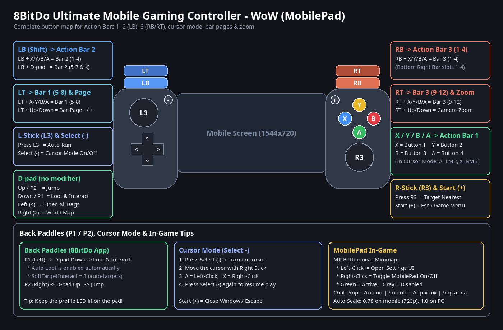

# MobilePad

Custom World of Warcraft controller keybindings addon that leaves your desktop keyboard bindings untouched. Built for mobile play (e.g., 8BitDo Ultimate Mobile Gaming Controller over Sunshine/Moonlight) with separate controller profiles for Xbox and iPhone setups.

## Features

- **Non-destructive keybindings:** Uses override bindings and combat-safe `SecureHandler` frames (`LB`, `RB`, `LT`, `RT`) without overwriting your keyboard action bar binds.
- **Profiles:** Switch between `Mobile (8BitDo)`, `Xbox (Split)`, and `Alt (iPhone)` in the settings UI or via slash commands.
- **Cursor Mode:** Toggle mouse cursor control with `Select (-)` / `View`, move the cursor with the right stick, and use `A` = Left-Click / `X` = Right-Click (with an on-screen `CURSOR ACTIVE` indicator and forced software cursor compatibility for Wine/Proton/Moonlight).
- **Auto UI Scale:** Optionally applies `0.78` UI scale on 720p mobile displays and restores your PC scale afterward.
- **Target Quest Tracker:** Shows quest objective / quest item status next to your target frame.

## Default Controls (8BitDo / Mobile Profile)

| Input | Action |
|---|---|
| `X` / `Y` / `B` / `A` | Action Bar 1 (Buttons 1–4) |
| `LB` + `X` / `Y` / `B` / `A` | Action Bar 2 (Buttons 1–4) |
| `LB` + `RB` | Toggle Berserker Stance ↔ Battle Stance |
| `LB` + D-pad | Action Bar 2 (Buttons 5–7 & 12) |
| `LT` + `X` / `Y` / `B` / `A` | Action Bar 1 (Buttons 5–8) |
| `LT` + `Up` / `Down` | Previous / Next Action Bar Page |
| `RB` + `X` / `Y` / `B` / `A` | Action Bar 3 (Bottom Right Buttons 1–4) |
| `RT` + `X` / `Y` / `B` / `A` | Action Bar 3 (Bottom Right Buttons 9–12) |
| `RT` + `Up` / `Down` | Camera Zoom In / Out |
| D-pad `Up` / `Down` / `Left` / `Right` | Jump / Loot & Interact / Open All Bags / World Map |
| `L3` / `R3` | Auto-Run / Target Nearest Enemy |
| `Select (-)` / `Start (+)` | Toggle Cursor Mode / Game Menu (Esc) |
| `Share` (`xbox` profile) | Quest Log |

## Installation

Copy the `MobilePad` folder into your World of Warcraft `Interface/AddOns/` directory and `/reload` (Interface `16001`).

## In-Game Usage

- **Minimap Button (`MP`):**
  - Left-Click: Open settings UI
  - Right-Click: Toggle MobilePad On / Off
  - Shift + Drag: Move minimap button
- **Slash Commands (`/mp` or `/mobilepad`):**
  - `/mp` — Toggle settings window
  - `/mp on` / `/mp off` — Enable or disable controller overrides
  - `/mp mobile` / `/mp xbox` / `/mp iphone` — Switch profile
  - `/mp cursor` — Toggle cursor mode
  - `/mp quest` — Toggle target quest-item tracker
